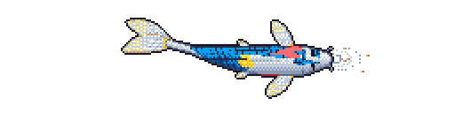

# Hey, I'm Ritik Pathania 👋
**Software Engineer · Backend · AI Systems · Rust & Go Enthusiast**

---

I'm a software engineer passionate about building scalable backend systems, developer tools, and AI-powered applications.

Most of my work revolves around Python, Rust, Go, and distributed systems. I enjoy designing reliable APIs, high-performance services, developer infrastructure, and automation that makes engineering simpler rather than more complicated.

Recently, I've been exploring compiler-inspired AI architectures, retrieval systems, agentic workflows, and systems programming. I'm particularly interested in how modern tooling can improve developer productivity without sacrificing performance, correctness, or simplicity.

_When I'm not building software, you'll probably find me learning something new, optimizing something that was already fast, or contributing to open-source._

## Tech Stack

---

## What I'm Working On

- 🦀 Building high-performance systems in Rust
- 🤖 Exploring LLMs, RAG, and Agentic AI
- ⚡ Building scalable backend services with Python & Go
- 🏗️ Learning distributed systems and system design
- 🌱 Contributing to open-source projects

---

## Connect With Me

---

> *"Build things that are simple, reliable, and fast."*
